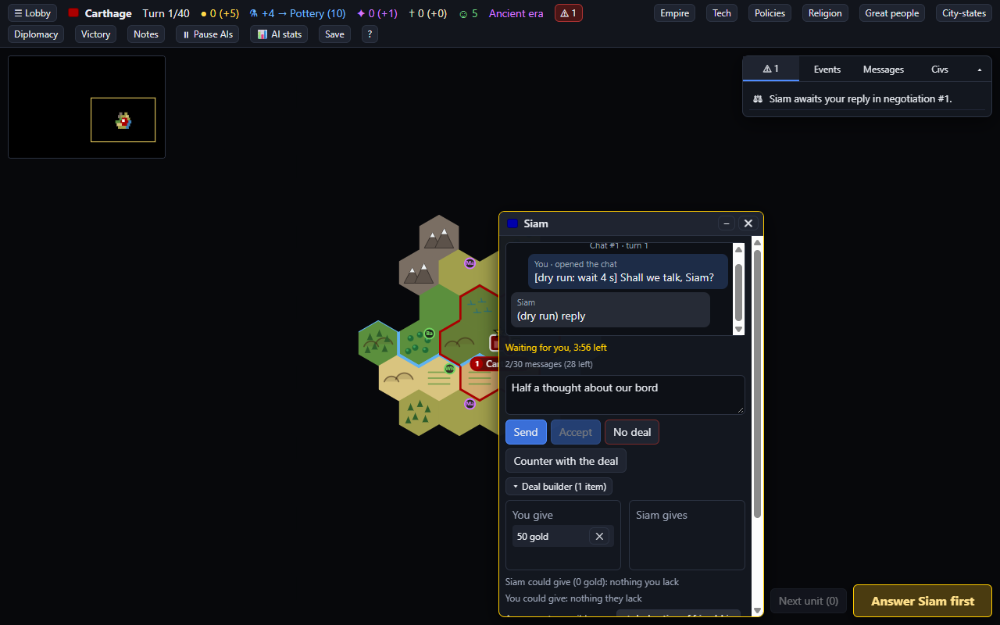

# Playing in the browser

CITAR's client is a single page served by the game server. Everything below works the same whether
the server is on your own machine or somewhere else.

## Starting, resuming and watching

The lobby lists running games and saved ones.

- **Create game** — map, speed, difficulty, victory conditions and seats. Each seat picks a
  civilization or takes a random one; you can rename your civ and your cities afterwards.
  **BenchmarkCiv** has no unique abilities, units or buildings, which is what benchmark seats use
  so that a comparison is about the player and not the civ.
- **Map generation** (the fold-out panel above the seats) changes the world itself:
  - **Map edges**: ice caps north and south (the default), wrapping east-west like a globe,
    wrapping north-south, wrapping both ways (no edges and no ice at all), or boxed in with ice on
    all four sides. The ice is a band one to four tiles deep that drifts slowly along the edge. On a
    wrapping map, units, borders and distances all go the short way round, and the view scrolls
    without end.
  - **Rivers**: 0% for none, 100% for normal, up to 300%. Every river runs downhill to the sea, and
    rivers that meet join into one instead of crossing.
  - **Resources**: an overall density, a density each for strategic, luxury and bonus resources,
    and a rule for any single strategic or luxury resource — **Off**, **At most** a number of tiles
    (1 gives the whole world a single source), or **Share %** of every resource of its kind. Sparse
    luxuries, heaps of strategics and no uranium is: luxury 30%, strategic 300%, Uranium off.
- **If an AI's model server disconnects**: pause the game until it answers again, or skip that
  AI's turn. Either way the seat first keeps retrying for the reconnect wait (180 seconds by
  default), so a short drop costs nothing — see [AI_PLAYERS.md](AI_PLAYERS.md#when-the-model-server-goes-away).
- **Chat**: how long a chat waits for an answer, and how long it may grow (see
  [Chat settings](#chat-settings)).
- **Load** on a saved game with a human seat takes you straight in. Games with no LLM seats resume
  automatically; games with them start paused so you can check the model settings first.
- **▶ Play** resumes a running game. **Watch** opens a game with no human seat with full vision.
- **Delete** removes every save of a game.

Games autosave every turn to `saves/<game id>/autosave.citar`. **Save** in the game screen writes a
named save beside it. A save holds the game as it stands; the game's history (its events, statistics
and the replay's frames) is in the journal beside it, `journal.cjnl`, which every save of the game
shares, so a save stays small however long the game runs. Keep a game's folder together: a save
copied without its journal does not load. Saves are written while the game plays on, so even a game
of bots alone is saved every turn. Loading an older save and playing on from it starts a new
timeline in a new journal (`journal-2.cjnl`, ...), and every other save of the game still loads.
Saves made by version 0.1.5 or earlier (the Python engine) do not load in this version.

### Watching AI games

With no human seat you can watch with full vision, pause, put a delay between AI turns, view the
map as a particular civilization saw it, and read each AI's reasoning as it arrives. This is the
most useful thing in CITAR for understanding *why* a model is losing.

## On a phone

Opening the server on a phone gives the **phone site**: a check-in rather than the game — running
games and their standings, whose turn it is, what each AI is doing (and whether one is waiting for
its model server), benchmark progress, reports, and which machines are online, with Pause/Resume
for games you manage. **Desktop site** at the bottom switches to the full client, and the choice is
remembered; **📱 Mobile site** in the full client's header switches back. `/m` always opens the
phone site, which is handy for looking at it from a desktop.

## The map

| Action | How |
|---|---|
| Select a unit | Left-click it |
| Move | With a unit selected, click a tile — hover first to see the route and turn count |
| Attack | Red tiles are targets; the tooltip predicts the damage and the outcome |
| Capture a civilian | Move onto it |
| Pan | Drag |
| Zoom | Scroll |
| Next unit needing orders | `N`, or it is selected automatically after one finishes |

Clicking a city tile selects, in order: units that still need orders, then the city, then units
that have already moved. Whatever else is on the tile appears as one-click chips under "Also here"
or "In city", and a city's name banner always opens the city.

Settlers and work boats show suggested sites as green dashed tiles. Tile tooltips show yields.

### Keys

`N` next unit · `F` fortify · `S` sleep · `Space` skip · `E` explore · `A` automate worker ·
`B` found city · `R` road · `H` heal · `P` pillage · `T` tech tree · `D` diplomacy ·
`C` centre on capital · `Shift+Enter` end turn

## Cities

The production queue can be reordered (▲ ▼) and edited (✕). **Now** puts something at the front,
**+ Queue** adds it to the end, and the gold button buys it outright. Click a tile in the city's
area to lock a citizen onto it (🔒). **Auto-pick production** hands the choice to the built-in
advisor whenever the queue empties.

## What needs attention

The buttons beside **End Turn** jump to the thing that needs you: a city with an empty queue, the
tech tree when research is idle, a city that can bombard an enemy in range, a promotion to pick.

The ⚠ tab in the side panel lists problems — falling gold, unhappiness, threatened cities, starving
cities, civilians in danger — and clicking one takes you there. End Turn warns about idle cities or
empty research before it lets the turn go.

**Empire** in the top bar summarises gold, happiness, science and victory progress, and lists every
city and unit, with obsolete units flagged and a Disband button for cutting upkeep.

## The empire screens

In the top bar: the tech tree, social policies, religion (pantheon, founding, enhancing), great
people, espionage (spies, coups), city-states (gifts, protection, tribute), and victory progress
for every victory type.

**Tech tree** turn estimates include missing prerequisites, so a tech four steps away shows what it
really costs. Clicking a locked tech sets it as a research goal and CITAR fills in the path. The
mouse wheel scrolls the tree sideways.

**Diplomacy** (`D`) shows where you stand with each civilization you have met: war or peace,
treaties, embassies and agreements. You denounce and declare war here, send messages (a message
gets no reply; a chat does), and cast your United Nations vote. Each civilization has **Open chat**,
which opens its chat window.

### Chatting

A negotiation is a chat with one civilization, one message each in turn. Each chat has a window docked
along the bottom of the screen, to the left of End Turn. There is one window per civilization, since
two civilizations have one chat open at a time, and play goes on while it is open.

- **It pops up.** A chat another civilization opens with you appears at once, whoever's turn it is.
  Their answers appear as they come, with a proposal as a card in the conversation and the game's own
  notes in grey ("(no reply in time)"). A window you closed comes back with their next word, or when
  the chat ends (they accept, decline or run out of time).
- **Your move, their move.** You write only when it is your move. Otherwise the window says what the
  other side is doing: "Rome is thinking…", "queued #3, about 40 s" while an AI's model waits for its
  machine, or "Waiting for Rome, 4:12 left". On your move it shows the time you have left: "Waiting
  for you, 3:12 left". When the time runs out, the chat closes as the [chat settings](#chat-settings)
  say.
- **Answering.** **Send** (or Enter) sends your message as a reply, and the other side answers it.
  **Accept** takes the proposal on the table, **No deal** declines, and **Counter with the deal**
  proposes what is in the deal builder. Each answer carries the text you typed, or a plain line
  ("Agreed.", "No deal.") when the box is empty. While you wait for them, **Withdraw** gives up a chat.
  Under the status line the window counts the chat's messages against the game's cap ("12/30
  messages (18 left)"), warning when two or fewer are left: the message that would pass the cap closes
  the chat instead.
- **The deal builder** sits in the window and folds away. It holds what you give and what they give:
  gold, gold per turn, resources, open borders, embassies, peace, declarations of friendship,
  research agreements, defensive pacts, war on a third party, cities, maps and technologies.
  One-click suggestions show what each side has that the other lacks. **Load into the builder**
  copies the proposal on the table, so you can change it and counter.
- **Starting a chat.** On your own turn, write a message or build a deal in a civilization's window,
  then press **Open chat** (or **Propose the deal**). Bots answer at once, AI models in their own time.
- **What you are writing stays.** A half-written message and the deal you are building survive
  everything that happens meanwhile, and closing and reopening the window, but not reloading the page.
- **Minimise** (–) folds a window into a tab, which lights up when the other side says something.
  **Close** (✕) only hides the window; the chat goes on, and End Turn, Diplomacy or the other side's
  next word opens it again. When the windows do not fit beside End Turn, the oldest fold into tabs.
- **The windows keep clear of the panels**: of a unit's panel at the bottom left, a city's panel above
  End Turn and the side panel at the top right. When there is no room left beside them, the windows
  show one at a time above End Turn, as on a narrow screen, and an open unit or city panel lies over
  them until you close it.
- **End Turn** waits for your chats, because a turn cannot end while one you are in is open. While a
  chat waits on you, the button reads "Answer Rome first" and opens that chat. While a chat waits on
  the other side, it reads "Waiting for Rome… 4:12". Click it then and it reads "End turn when they
  answer": the turn ends by itself once every chat has closed. Click again to cancel. Other
  unfinished business (idle units, no research) is checked first, as for any end of turn, and again
  when the turn would end by itself, on the game as it stands after the last answer, since a deal can
  bring something new to decide (a technology that finishes your research, a city); Ctrl+click skips
  that check both times. If the screen cannot fetch the game just then, it stays armed and tries again
  a second later.
- **On a narrow screen** (700 pixels wide or less) one window shows at a time, full width above End
  Turn, with a tab for each chat.

### Chat settings

A negotiation is a chat between two civilizations, one message each in turn. The lobby's **Chat** row
sets how long a chat waits for the side whose move it is, and how long it may grow:

| Setting | Default | When it runs out |
|---|---|---|
| **AI answers within** (minutes) | 10 | An AI model (an LLM or MCP seat) that has not answered is taken to have declined, "(no reply in time)". The time it spends waiting for its machine counts. |
| **People within** (minutes) | 5 | The chat closes as expired, "(no reply in time)", whoever opened it: an AI waiting on you, or another person. |
| **At most ... messages** | the rules' own (30) | The message that would pass it closes the chat instead. Left empty, the game keeps its ruleset's cap. |

Bots answer at once and are never timed. The clock stands still while the game is paused, starts again
each time the chat moves, and starts afresh for every open chat when a game is loaded or the server
restarts. A game loaded from a save comes back paused: its bots answer what waits on them at once, its AI
models once you resume it, so you can check their settings before they spend anything. Nobody can end their turn while a chat they opened is open: an AI's turn waits for your
answer, as long as the setting allows.

## After the game

**Recap** — available when a game ends, and at any time for AI-only games — scrubs through every
turn: territory, cities and units on the map, score, military and tech graphs, per-turn events,
diplomatic messages, and every AI's recorded reasoning. You can show the map as a particular player
saw it, which is the only honest way to judge a decision made under fog of war.

**📊 AI stats** (top bar, or **Stats** in the lobby) shows live per-seat metrics for any game with
an AI player: turn times, model steps, tool calls, errors, loops, tokens, and how each turn ended.
[BENCHMARKS.md](BENCHMARKS.md#what-the-metrics-mean) explains what each number is for.

## Playing with other people

Start the server with `--host 0.0.0.0` and other people on your network can join with their seat
link. For anything beyond that — accounts, invitations, sharing and budgets — run a server:
[server/DEPLOY.md](server/DEPLOY.md).
